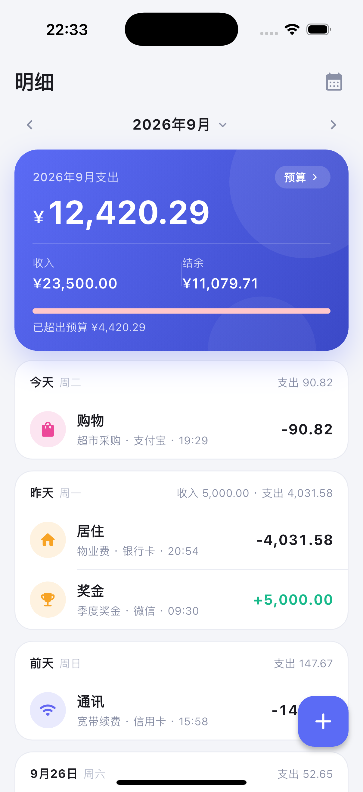
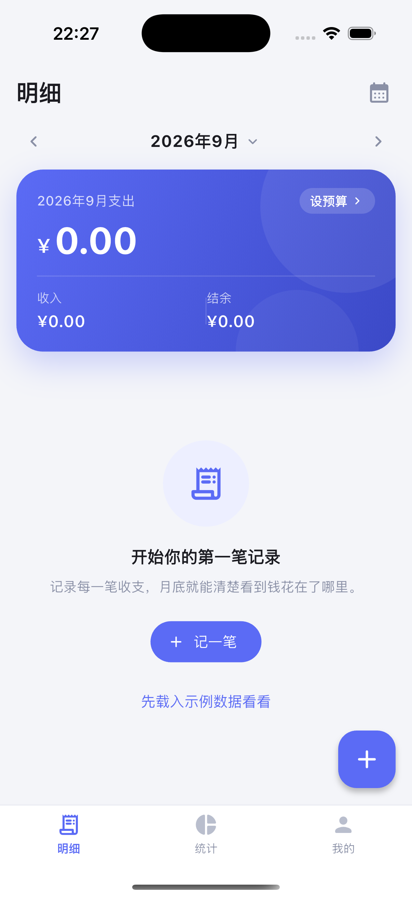

# 轻记账 · Ledger App


一个用 Flutter 写的 **iOS 本地记账 App**：数据全部保存在设备本地，不联网、不上传，
打开就能记一笔。支持多账户、分类统计、月度预算、主题切换和 CSV 导出。

> 技术栈：Flutter 3.29.3 / Dart 3.7.2 · 状态管理 provider · 本地存储 sqflite · 图表 fl_chart

[](LICENSE)

| 明细                                        | 空状态                                      |
| ------------------------------------------- | ------------------------------------------- |
|  |  |

---

## 功能

### 明细（首页）

- 顶部渐变汇总卡：本月支出、收入、结余，以及月预算进度条和超支提醒。
- 按天分组的账单流：显示「今天 / 昨天 / 前天 / 9月26日」、星期、当日收支合计。
- 每条记录显示分类图标、分类名、备注 · 账户 · 时间，支出为深色、收入为绿色并带 `+`。
- 左滑单条记录即可 **编辑 / 删除**，删除前有二次确认。
- 月份左右切换，或点月份标题直接跳到任意年月。
- 没有任何数据时提供「先载入示例数据看看」的入口。

### 记一笔 / 编辑

- 支出 / 收入分段切换，切换后自动匹配对应分类。
- 大字号金额显示 + 闪烁光标，配 iOS 风格自定义数字键盘（小数点、退格、保存）。
- 账户、日期（原生滚轮选日期）、备注三个快捷胶囊，点开即改。
- 分类九宫格（每行 5 个），收入与支出各有一套分类。
- 编辑已有记录时，右上角可直接删除。

### 统计

- 月份切换 + 支出 / 收入两个视角。
- 本月金额、笔数、日均支出三个关键指标。
- 环形图展示分类占比，中心显示当月总额（超过 6 个分类时自动合并为「其他」）。
- 分类排行：进度条 + 百分比 + 金额，按金额从高到低。
- 近 6 个月趋势：支出 / 收入双柱状图，并给出 6 个月合计。

### 我的

- 资产卡片：总资产（所有账户余额之和）、累计收入、累计支出。
- 账户管理：新增 / 编辑 / 删除账户，可设置图标、颜色、账户类型和初始余额。
- 分类管理：支出 / 收入两个 Tab，支持新增、改名、换图标、换颜色、删除。
- 月预算：设置后首页汇总卡会显示预算进度，填 0 即关闭。
- 主题：跟随系统 / 浅色 / 深色，选择会被记住。
- 数据：导出 CSV（UTF-8 BOM，Excel 中文不乱码）、载入示例数据、清空所有记录。

> 首次启动是**完全空白**的：只有一套默认分类，没有任何账户、没有账单，
> 总资产就是 `¥0.00`。钱只会出现在你亲手记下的账里。

---

## 快速开始

### 环境要求

| 项目         | 版本                       |
| ------------ | -------------------------- |
| Flutter      | 3.29.x（Dart 3.7.2）       |
| Xcode        | 16.x（本工程用 16.2 验证） |
| CocoaPods    | 1.16+                      |
| iOS 最低版本 | iOS 13.0                   |

### 运行

```bash
flutter pub get

# 查看可用设备
flutter devices

# 运行到 iOS 模拟器（把 <device-id> 换成上面列出的设备）
flutter run -d <device-id>
```

模拟器可以用图形界面打开：`open -a Simulator`；
也可以用命令行启动指定机型：

```bash
xcrun simctl list devices available
xcrun simctl boot "iPhone 16 Pro"
```

### 打包

```bash
# 模拟器包（不签名，本地验证用）
flutter build ios --simulator --no-codesign

# 真机 / 发布包
flutter build ios --release
```

真机安装需要在 `ios/Runner.xcodeproj` 里选择自己的 Team，并按需修改
`PRODUCT_BUNDLE_IDENTIFIER`（当前为 `com.ledgerapp.ledgerApp`）。
App 在桌面上的显示名是**轻记账**，定义在 `ios/Runner/Info.plist` 的 `CFBundleDisplayName`。

### macOS 版（DMG）

项目同时支持 macOS，一条命令即可打出 DMG 安装包：

```bash
./tool/build_macos_dmg.sh
# 产物：build/轻记账-1.0.0.dmg
```

打开 DMG，把「轻记账」拖进 `Applications` 就装好了。要点：

- 产物是 **arm64 + x86_64 通用二进制**，Intel 和 Apple 芯片的 Mac 都能跑。
- 使用**临时签名（ad-hoc）**，本机生成、本机安装不受影响；
  如果通过网盘 / 聊天工具传给别的 Mac，首次打开需右键 →「打开」，
  或执行 `xattr -d com.apple.quarantine /Applications/轻记账.app`。
- 数据库存放在应用沙盒内：
  `~/Library/Containers/com.ledgerapp.ledgerApp/Data/Library/Application Support/`
- 界面是为手机比例设计的，桌面窗口默认打开成 430×880 并居中，可自由缩放（最小 380×620）。

### 测试与静态检查

```bash
flutter analyze   # 0 issue
flutter test      # 26 个测试全部通过
```

测试分三层，都不依赖真机或模拟器：

| 文件                             | 覆盖内容                                                                 |
| -------------------------------- | ------------------------------------------------------------------------ |
| `test/formatters_test.dart`      | 金额千分位 / 正负号 / 紧凑格式、键盘输入解析、日期文案                   |
| `test/ledger_provider_test.dart` | 初始化、增删改、月份切换、按天分组、分类统计、趋势、预算、主题持久化     |
| `test/app_test.dart`             | 真机尺寸下的完整交互：首次启动引导建账户、记一笔、空状态、切月份、统计图表、设置页、深色主题 |

---

## 项目结构

```
lib/
├── main.dart                      # 入口：创建 Provider 并启动 App
├── app.dart                       # MaterialApp、主题与主题模式
├── models/                        # 纯数据模型
│   ├── types.dart                 # TxType（支出/收入）、AccountKind
│   ├── transaction_record.dart    # 一笔收支记录
│   ├── category.dart              # 分类
│   ├── account.dart               # 账户（钱包）
│   └── app_data.dart              # AppData / DaySection / CategoryStat / TrendPoint
├── data/                          # 持久化层
│   ├── ledger_store.dart          # 存储抽象接口
│   ├── sqflite_ledger_store.dart  # SQLite 实现（生产环境）
│   ├── memory_ledger_store.dart   # 内存实现（测试与预览）
│   └── default_data.dart          # 默认分类 / 账户 / 示例账单生成器
├── providers/
│   └── ledger_provider.dart       # 单一数据源：缓存 + 派生统计 + 增删改
├── screens/
│   ├── root_shell.dart            # 底部三个 Tab 的外壳
│   ├── home_screen.dart           # 明细
│   ├── transaction_editor_screen.dart  # 记一笔 / 编辑
│   ├── stats_screen.dart          # 统计
│   ├── settings_screen.dart       # 我的
│   ├── categories_screen.dart     # 分类管理
│   ├── category_editor_screen.dart
│   └── account_editor_screen.dart
├── widgets/                       # 可复用组件
│   ├── summary_card.dart          # 渐变汇总卡
│   ├── transaction_tile.dart      # 账单行 + 日分组标题
│   ├── amount_keypad.dart         # 自定义数字键盘
│   ├── month_switcher.dart
│   ├── tx_type_selector.dart      # 支出/收入分段控件
│   ├── sheets.dart                # 选月份/选账户/选日期/备注/确认弹窗
│   ├── pickers.dart               # 图标与颜色选择器
│   └── charts/                    # 环形图、趋势柱状图
├── theme/app_theme.dart           # 颜色令牌（含深色模式）+ 全局主题
└── utils/
    ├── formatters.dart            # 金额与日期格式化
    └── icon_registry.dart         # 图标 key ↔ IconData 映射

tool/
└── generate_app_icon.dart         # 生成 iOS 全套 App 图标（见下文）

docs/
├── app-icon.png                   # 1024×1024 图标源图
└── screenshots/                   # README 用的真机截图
```

### 架构与数据流

```
UI (screens / widgets)
        │  watch / read
        ▼
LedgerProvider (ChangeNotifier)   ← 唯一数据源，内存中持有全部数据
        │  派生：按天分组 / 分类占比 / 月度趋势 / 账户余额
        ▼
LedgerStore (抽象接口)
        ├── SqfliteLedgerStore  → 设备本地 ledger.db
        └── MemoryLedgerStore   → 单元测试与预览
```

几点设计取舍：

- **金额用整数「分」存储**，避免浮点误差；展示时才格式化成 `¥1,234.56`。
- **账单一次性读入内存**，派生统计在 Dart 里算。个人记账的数据量很小，
  这样能省掉复杂的聚合 SQL，也让统计逻辑可以脱离数据库单独测试。
- **存储层抽象**：UI 与 Provider 只依赖 `LedgerStore`，测试注入内存实现即可，
  不需要真机，也不需要 sqflite 的平台通道。
- **账户余额是算出来的**：`初始余额 + 累计收入 − 累计支出`，不单独存字段，避免对不上账。
- **分类 / 账户被引用时不允许删除**，Provider 会返回明确的中文提示。
- **账户属于用户**：首次启动不会替用户创建任何账户或余额。升级到该版本时，
  如果检测到旧版本自动创建、且用户从未动过的那 5 个账户，会一次性清理掉，
  避免账面上凭空多出一笔钱。

### App 图标

图标不是位图素材，而是用代码画出来的（渐变底 + 粗体 ¥ 标记）。
每个尺寸都按矢量几何独立渲染再面积平均，缩到 20×20 依然干净，
并且 PNG 一律不带 alpha 通道——App Store 会拒绝带透明通道的图标。

```bash
dart run tool/generate_app_icon.dart
```

它会重写 `ios/Runner/Assets.xcassets/AppIcon.appiconset/` 下全部 15 个尺寸，
并把 1024×1024 源图输出到 `docs/app-icon.png`。
想换配色或字形，改脚本顶部的 `_topColor` / `_bottomColor` 与 `_segments` 即可。

### 数据库表

| 表           | 说明     | 关键字段                                                              |
| ------------ | -------- | --------------------------------------------------------------------- |
| `categories` | 分类     | `id, name, icon, color, type(expense/income), sort_order, is_system`  |
| `accounts`   | 账户     | `id, name, icon, color, kind, initial_balance, sort_order, is_system` |
| `records`    | 收支记录 | `id, type, amount, category_id, account_id, note, date, created_at`   |
| `settings`   | 键值配置 | `key, value`（`theme_mode`、`monthly_budget`）                        |

`color` 存 ARGB 整数，`icon` 存字符串 key（见 `utils/icon_registry.dart`），
这样表结构不依赖 Flutter 图标的数字码点，后续增删图标也不会破坏已有数据。

---

## 常见问题

**CocoaPods 报 `Unicode Normalization not appropriate for ASCII-8BIT` 或提示需要 UTF-8？**

终端 locale 不是 UTF-8 导致的，加上环境变量再跑即可：

```bash
env LANG=en_US.UTF-8 LC_ALL=en_US.UTF-8 flutter build ios --simulator --no-codesign
```

**数据存在哪里？**

设备本地的 SQLite 文件 `ledger.db`，位于 App 沙盒的数据库目录。
卸载 App 会一起删除；App 内也可以用「我的 → 清空所有记录」单独清空账单。

**为什么第一次打开一个账户都没有？**

这是有意设计的：账户和余额都属于你自己，App 不替用户编造数据。
点「我的 → 添加账户」可以一键套用现金 / 银行卡 / 支付宝 / 微信 / 信用卡模板；
直接去「记一笔」点账户胶囊，也会先引导你创建第一个账户。

**为什么删除分类 / 账户时提示无法删除？**

该分类或账户下还有账单记录。先把这些记录改成别的分类 / 账户，或直接删除这些记录。

**想换成自己的颜色 / 图标？**

分类色板在 `theme/app_theme.dart` 的 `kAccentPalette`，
可选图标在 `utils/icon_registry.dart` 的 `kIconRegistry` / `kIconKeys`。

---

## 版本

当前版本 `1.0.0+1`（见 `pubspec.yaml`）。

## 许可

本项目基于 [MIT 许可证](LICENSE) 开源：你可以自由使用、修改、分发，甚至用于商业项目，
只需在副本中保留原始的版权声明和许可声明。软件按「原样」提供，不附带任何形式的担保。

```
Copyright (c) 2026 baihaowen
```

第三方依赖（provider、sqflite、fl_chart、flutter_slidable、uuid、path、path_provider 等）
均为 MIT / BSD 等宽松许可，可以安全用在闭源与商业项目中。
